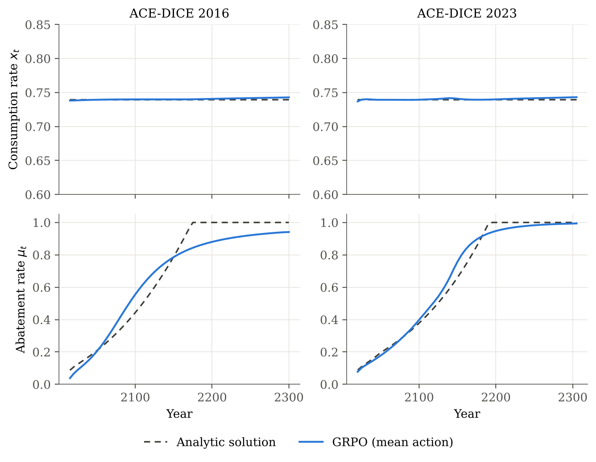

# 4. Extension: GRPO for ACE

Group Relative Policy Optimization (GRPO) applied to the Analytic Climate Economy, as a
model-free counterpart to the model-based actor-critic in [`../3_actor_critic/`](../3_actor_critic/).
This directory is self-contained: it has its own copy of the environment and benchmark, its
own training code, results and tests. It does not import from parts 1–3.

## Idea

GRPO is PPO without a critic. For each prompt it samples a group of responses and uses each
response's reward, normalized within the group, as its advantage. Applied to ACE:

- **Policy:** a Gaussian in logit space over the consumption rate `x` and the abatement rate
  `μ`, with a learnable standard deviation. Evaluation uses the mean action.
- **Prompts and groups:** a prompt is a start state on the current policy's trajectory. From
  each, a group of 16 trajectories of 40 periods is sampled.
- **Advantages:** *process* (default): each action's discounted return-to-go, normalized across
  the group at the same step. *Outcome* (ablation): the trajectory's discounted return,
  normalized across the group and shared by all of its actions.
- **Update:** the PPO clipped objective, 4 epochs of 4 mini-batches per iteration. There is no
  KL penalty, since there is no reference policy.
- **Model-free:** the environment is only sampled. Unlike the actor-critic, nothing is
  differentiated through the dynamics, and there is no value function.

Without a critic there are no costates, so the SCC is read off the policy instead: the marginal
abatement cost at the chosen abatement rate, which equals the SCC at an optimum wherever full
abatement does not bind.

## Results

Trained for 2000 iterations (41 million environment transitions per run), one seed per run.
Errors are measured against the closed-form solution over the periods up to 2300. The
actor-critic (part 3) and the DEQN (part 2) are shown for comparison.

| | GRPO 2016 | GRPO 2023 | Actor-critic 2016 | Actor-critic 2023 | DEQN 2016 | DEQN 2023 |
|---|---|---|---|---|---|---|
| max \|x − x*\| | 0.0034 | 0.0037 | 0.0126 | 0.0069 | 0.0006 | 0.0028 |
| mean \|μ − μ*\| | 0.075 | 0.029 | 0.014 | 0.012 | 0.0009 | 0.0020 |
| max \|μ − μ*\| | 0.156 | 0.102 | 0.058 | 0.060 | 0.017 | 0.023 |
| SCC, mean relative error | 26% | 12% | 1.2% | 3.0% | 0.2% | 0.6% |
| Welfare loss (consumption equivalent) | 0.008% | 0.003% | 0.039% | 0.004% | – | – |



**Consumption is learned well, abatement less so.** GRPO gets the consumption rate closer
to the optimum than the actor-critic. It also learns the shape of the abatement path, but
less precisely: in the DICE 2016 model it abates too much around 2100 and approaches full
abatement too slowly. The consumption decision changes the return by much more than the
abatement decision, so the sampled returns carry a much weaker signal for abatement.

**The SCC is where the methods differ most.** Without a critic, GRPO's SCC is the marginal
abatement cost at its chosen abatement rate. Because that cost rises steeply in μ (as
μ^1.6), small abatement errors become large SCC errors: 12–26%, against 1–3% for the
actor-critic's critic gradient. A method without a value function has no direct estimate of
the shadow price of carbon.

**Welfare is a poor yardstick here.** GRPO has the lowest welfare loss of the two RL
methods, despite its larger abatement and SCC errors. Welfare is flat around the optimum and
dominated by consumption, so it barely registers errors in climate policy.

**Learning is slower and less stable.** The actor-critic reaches an abatement error of
about 0.02 within about 10 minutes of training. GRPO takes 45–60 minutes and ends above it;
its abatement error rises temporarily during training before falling again (see
`results/figures/learning.png`). Training times were measured with two to four runs sharing
four CPU cores, so they are indicative only.

**Process versus outcome advantages.** In the DICE 2016 model, outcome advantages (one
normalized return per trajectory) gave a lower abatement error (0.020) than process
advantages (0.075), in a single seed each (`results/figures/advantages.png`). Since both
variants show large swings during training, this difference may not survive more seeds.

## Layout

```
4_grpo/
├── code/
│   ├── ace_grpo/
│   │   ├── env.py         Differentiable ACE-DICE environment (copy of part 3)
│   │   ├── benchmark.py   Closed-form costates and optimal abatement (copy of part 3)
│   │   ├── exogenous.py   DICE 2016 / 2023 exogenous paths (copy of part 3)
│   │   └── grpo.py        GRPO
│   ├── configs/           Model and GRPO settings
│   ├── tests/             The benchmark is consistent with the dynamics
│   ├── train.py           python train.py --version 2016
│   └── make_results.py    Figures, tables and CSVs
└── results/               Figures, tables, trajectories, weights and logs
```

## Reproducing

```bash
cd 4_grpo/code
python -m pytest
python train.py --version 2016
python train.py --version 2023
python train.py --version 2016 --advantage outcome --tag _outcome   # ablation
python make_results.py
```

`make_results.py` also reads the saved results of the DEQN (`../2_revised/results/`) and the
actor-critic (`../3_actor_critic/results/`), as data only, for the comparison table and the
learning-curve figure.
