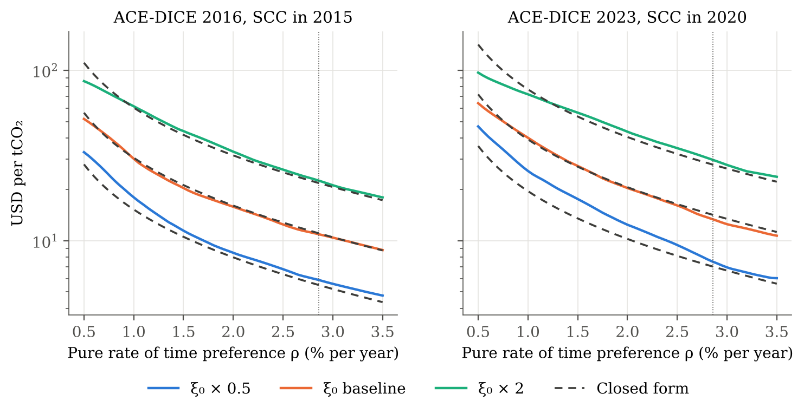
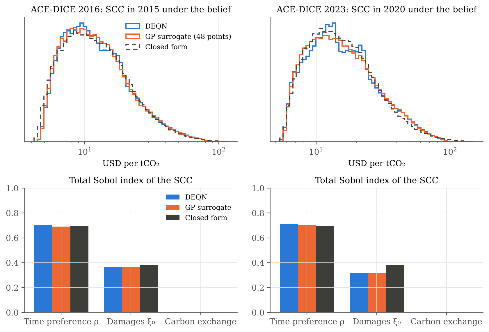

# 5. Extension: Deep Uncertainty Quantification for ACE

The approach of Friedl, Kübler, Scheidegger and Usui (*Deep Uncertainty Quantification: With an
Application to Integrated Assessment Models*), applied to the Analytic Climate Economy, where the
closed form gives exact answers to check it against. This directory is self-contained: it has its
own copy of the model, its own training code, results and tests, and does not import from parts 1–4.

## Idea

The DEQN of part 2 solves ACE-DICE for one calibration. Here, three uncertain parameters become
extra state variables, called *pseudo-states*:

| Parameter | Training range | Belief for the uncertainty analysis |
|---|---|---|
| Pure rate of time preference ρ | 0.5%–3.5% per year | Uniform |
| Damage coefficient ξ₀ | 0.011–0.044 (0.5× to 2× the baseline) | Log-uniform |
| Atmosphere–ocean carbon exchange (multiplier on DICE's exchange rates) | 0.75–1.25 | Uniform |

A pseudo-state is a network input like log capital or carbon, but stays constant along a
trajectory. Each training iteration simulates 16 trajectories, each with its own parameter draw,
and minimises the corrected equilibrium conditions of part 2 on the visited states. The result
is a single network that solves the model for every parameter vector in the range. Nothing else
changes: the residuals are those of part 2, with β, ξ₀ and the carbon matrix Φ read from each
sample.

The uncertainty analysis then works on the trained network instead of re-solving the model:

1. **Surrogate.** A Gaussian process (GP) maps the parameters to the SCC in the first period. It is
   fitted by Bayesian active learning: start from 8 space-filling points, then repeatedly add the
   candidate with the largest posterior standard deviation, up to 48 points.
2. **Distribution.** 100,000 draws from the belief give the distribution of the SCC.
3. **Sobol indices.** These split the variance of the SCC between the parameters (Saltelli and
   Jansen estimators, 16,384 base draws).

Every step is repeated with the closed form, which is known for every parameter vector, and with
the DEQN evaluated directly, without the surrogate.

## Results

Trained for 6000 iterations, one seed per model. Errors are measured against the closed form on
256 test draws (a Sobol sequence over the training range), over the periods up to 2300.

| | DICE 2016: median | 90th pct. | max | DICE 2023: median | 90th pct. | max |
|---|---|---|---|---|---|---|
| max \|x − x*\| | 0.006 | 0.010 | 0.051 | 0.010 | 0.018 | 0.047 |
| mean \|μ − μ*\| | 0.003 | 0.011 | 0.028 | 0.011 | 0.030 | 0.059 |
| SCC, mean relative error along the path | 1.8% | 5.6% | 19% | 4.0% | 15% | 35% |
| SCC in the first period, relative error | 2.0% | 5.2% | 21% | 3.6% | 14% | 33% |



**One network covers a 30-fold range of the SCC.** Across the training range, the SCC in the
first period runs from about $4 to $140 per tCO₂. The network tracks the closed form across this
range, including how the SCC depends on time preference and damages (above).

**Precision is lower than when solving one calibration.** At the baseline parameters, the mean
SCC error is 2.0% (2016) and 2.5% (2023). The single-instance DEQN of part 2 reaches 0.2% and
0.6%. The network now has to fit a whole family of solutions with the same capacity and a
similar training budget.

**The errors concentrate at the edges of the range.** The largest errors are at very low
time preference combined with high damages. That is where the SCC is highest and abatement
reaches 100% within a few decades; there, the network approaches full abatement too slowly and
underestimates the SCC (`results/figures/paths.png`).



**The uncertainty analysis is accurate.** The DEQN and the GP surrogate reproduce the exact
distribution of the SCC and its Sobol indices:

| SCC in the first period (USD per tCO₂) | Mean | 5% | Median | 95% | Total Sobol index: ρ | ξ₀ | Carbon exchange |
|---|---|---|---|---|---|---|---|
| DICE 2016, closed form | 21.5 | 6.4 | 17.0 | 53.3 | 0.70 | 0.38 | 0.005 |
| DICE 2016, DEQN | 21.4 | 6.6 | 16.9 | 53.0 | 0.70 | 0.36 | 0.004 |
| DICE 2016, GP surrogate | 21.3 | 6.6 | 16.7 | 52.6 | 0.69 | 0.36 | 0.004 |
| DICE 2023, closed form | 27.6 | 8.2 | 21.8 | 68.2 | 0.70 | 0.38 | 0.005 |
| DICE 2023, DEQN | 27.4 | 8.3 | 22.4 | 63.0 | 0.71 | 0.32 | 0.003 |
| DICE 2023, GP surrogate | 27.4 | 8.2 | 22.5 | 63.0 | 0.70 | 0.32 | 0.003 |

Time preference explains most of the variance, then damages; the speed of carbon exchange with
the ocean barely matters. The total indices sum to more than one, because ρ and ξ₀ interact:
the SCC is roughly proportional to damages times the discounted horizon. The main bias is in
the upper tail of DICE 2023 (95th percentile $63 against $68), which comes from the high-SCC
edge of the range described above.

**The GP is limited by the network, not by the number of points.** The surrogate's largest
error against the DEQN falls to 3–4% after about 30 design points and then levels off
(`results/figures/learning.png`). The DEQN's SCC surface has small bumps that a smooth GP does
not follow. With 48 points, the GP matches the DEQN evaluated on all 100,000 draws.

**The cost.** Training took 53 minutes (DICE 2016, sharing four CPU cores with two other runs)
and 38 minutes (DICE 2023, alone), against 24 minutes for one calibration in part 2. The
uncertainty analysis needs the solution at about 180,000 parameter vectors. Re-solving each one
with part 2 is out of reach, while the pseudo-state network evaluates all of them in seconds.

### Ablation: weighting the recursive conditions

A residual ε in a recursion such as λ = β(… + λ′) becomes an error of order ε/(1 − β) in λ, so
low time preference should need smaller residuals. Weighting the recursive conditions by
1/(1 − β) (`--discount-weighting`) tests this. It lowered the median SCC error at ρ ≤ 1% by about a third (1.3%
against 1.9%), but made every other statistic worse (DICE 2016, same 6000 iterations,
`results/tables/ablation.csv`):

| Weights | Median SCC error | 90th pct. | Max | Median, ρ ≤ 1% | Median \|μ − μ*\| |
|---|---|---|---|---|---|
| Equal (default) | 1.8% | 5.6% | 19% | 1.9% | 0.003 |
| 1/(1 − β) | 2.2% | 6.9% | 24% | 1.3% | 0.009 |

## Towards models without a closed form

ACE is the test case, not the goal. The same code applies to models without closed-form
solutions, such as tipping points or stochastic shocks; only the benchmark is lost. Two lessons
from this test carry over:

- **Check the edges of the parameter range.** Average errors are small; the large ones sit where
  constraints bind early.
- **Judge the surrogate against the network.** A GP fitted to network output inherits the
  network's error. Here, beyond about 30 points, extra design points do not help.

With a stochastic model, the expectation in the residuals would need quadrature or sampling over
the shocks, as in the original DEQN paper. A tipping point adds a regime state, and its hazard
parameters can be pseudo-states too.

## Layout

```
5_deep_uq/
├── code/
│   ├── ace_uq/
│   │   ├── exogenous.py   DICE 2016 / 2023 exogenous paths (copy of part 2)
│   │   ├── model.py       ACE-DICE with (prtp, xi_0, carbon exchange) as pseudo-states
│   │   ├── residuals.py   Corrected equilibrium conditions of part 2, per-sample parameters
│   │   ├── analytic.py    Closed form for any parameter vector
│   │   ├── network.py     Policy network
│   │   ├── training.py    DEQN training over parameter draws
│   │   └── surrogate.py   GP with active learning, belief sampling, Sobol indices
│   ├── configs/           Model, parameter ranges and training settings
│   ├── tests/             The closed form satisfies every condition, for any draw
│   ├── train.py           python train.py --version 2016
│   └── make_results.py    Figures, tables and CSVs
└── results/
    ├── figures/           scc_slices, accuracy, paths, uq, learning
    ├── tables/            accuracy, uq, ablation, cost
    ├── csv/               Per-draw errors on the test set
    └── runs/              Weights, training histories and logs
```

## Reproducing

```bash
cd 5_deep_uq/code
python -m pytest
python train.py --version 2016
python train.py --version 2023
python train.py --version 2016 --discount-weighting --tag _weighted   # ablation
python make_results.py
```

The uncertainty analysis needs scikit-learn and SciPy in addition to the packages of part 2.
