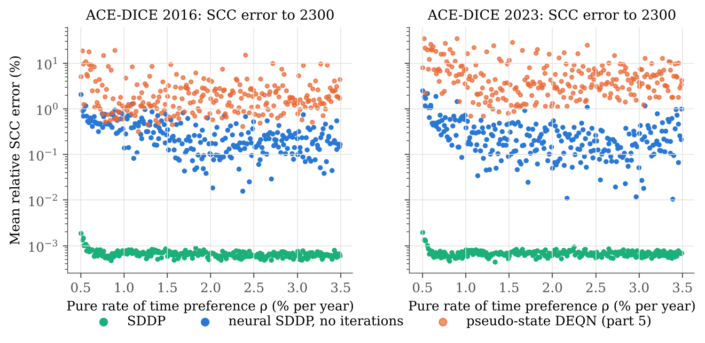
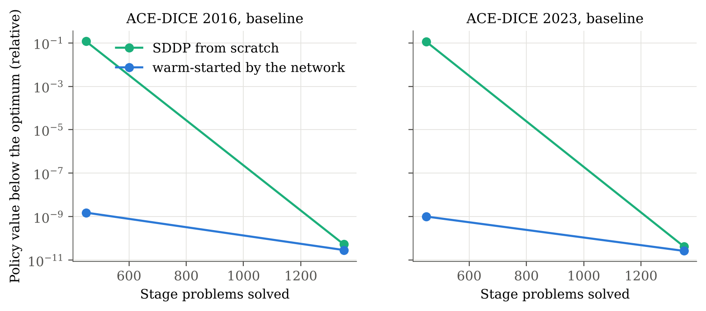

# 6. Extension: SDDP and neural SDDP for ACE

Stochastic dual dynamic programming (SDDP) solves the Analytic Climate Economy with cutting planes,
and neural SDDP (Dai, Xue, Syed, Schuurmans and Dai, 2021) learns those cutting planes across
parameter values. Both are checked against the closed form, and neural SDDP is compared with the
pseudo-state DEQN of part 5 on the same test draws. This directory is self-contained: it has its own
copy of the model, its own code, results and tests, and does not import from parts 1–5.

A draft paper on these results is in [`paper/`](paper/) ([PDF](paper/paper.pdf)).
The convexity properties SDDP relies on, among them the concavity of every value function, are
proved formally in Lean in [`lean/`](lean/).

## Idea

**SDDP.** Write ACE as a sequence of stage problems. In period t, choose the consumption rate x and
the abatement rate μ to maximise this period's utility plus the discounted value of the next state,
with the next period's value function approximated from above by *cuts*:

    V_t(s) = max_{x, μ}  log x + g_t(s, μ) + β θ,     θ ≤ α_j + b_j · s'(x, μ)  for every cut j.

With business-as-usual emissions on an exogenous path (ACE's assumption), next capital is concave in
(x, μ), carbon is affine in μ and the climate does not depend on the decisions, so every stage problem
is convex: a solver handles it in about a millisecond. SDDP then alternates two passes:

- **forward:** simulate the policy implied by the current cuts. Its value is a lower bound;
- **backward:** solve each stage at the visited state, from the last stage to the first, and add the
  cut given by the stage's value and its gradient. These cuts give an upper bound.

The gradient of a stage's value with respect to the incoming state follows from the envelope theorem
and the multipliers on the cut constraints. It is exactly the costate recursion behind the DEQN's
equilibrium conditions (part 2), so **the slopes of the cuts are ACE's costates**. In ACE the value
function is affine, so one cut per stage is exact, and the social cost of carbon follows directly from
the slopes of the next period's cut:

    SCC = 1000 · Y_net · (−ζ β b_M1) / (1 + β b_k).

**Neural SDDP.** A network maps the uncertain parameters (time preference, damages and carbon exchange,
over the same ranges as part 5) and the period to that period's cut. It is trained on cuts from SDDP
solutions of 128 parameter draws. For a new draw, its cuts are either used directly, with one forward
pass and no SDDP iterations, or used to warm-start SDDP. Dai et al. predict several cuts in a learned
low-dimensional space; ACE needs only one cut per stage, in the original six-dimensional state.

## Results

256 test draws (the same Sobol points as part 5), errors against the closed form over the periods up
to 2300. The table gives medians, with the maximum over all draws in brackets.

| | SDDP | Neural SDDP, no iterations | Neural SDDP, warm-started | Pseudo-state DEQN (part 5) |
|---|---|---|---|---|
| **DICE 2016** | | | | |
| SCC, mean relative error | 0.0007% (0.002%) | 0.24% (2.1%) | 0.0007% (0.002%) | 1.8% (19%) |
| SCC in the first period, relative error | 0.00001% (0.0008%) | 0.37% (3.3%) | 0.00001% (0.0008%) | 2.0% (21%) |
| mean \|μ − μ*\| | 0.00001 (0.00003) | 0.0003 (0.003) | 0.00001 (0.00003) | 0.003 (0.028) |
| max \|x − x*\| | 0.00002 (0.00005) | 0.00003 (0.00007) | 0.00002 (0.00005) | 0.006 (0.051) |
| **DICE 2023** | | | | |
| SCC, mean relative error | 0.0007% (0.002%) | 0.21% (2.5%) | 0.0007% (0.002%) | 4.0% (35%) |
| SCC in the first period, relative error | 0.00001% (0.0008%) | 0.26% (4.2%) | 0.00001% (0.0008%) | 3.6% (33%) |
| mean \|μ − μ*\| | 0.00001 (0.00002) | 0.0003 (0.004) | 0.00001 (0.00002) | 0.011 (0.059) |
| max \|x − x*\| | 0.00002 (0.00003) | 0.00003 (0.0001) | 0.00002 (0.00004) | 0.010 (0.047) |
| **Cost per draw** | 2.6 s, 1,350 stage problems | 0.9 s, 450 stage problems | 2.6 s, 1,350 stage problems | |



**SDDP solves ACE exactly, in two iterations.** The first backward pass computes exact cuts at every
stage, because a cut at any state is exact when the value function is affine. The second forward pass
then follows the optimal policy, and the bounds meet. The remaining errors, around 10⁻⁵, are the
solver's tolerance. This is a third route to ACE's shadow prices: residuals of the equilibrium
conditions in parts 2 and 5, the critic's gradient in part 3, and here the cut slopes, computed from
the duals of convex programs.

**Neural SDDP without iterations is accurate and cheap.** One forward pass with the predicted cuts
gives the SCC within 0.2% (median) and abatement within 0.0003, and the welfare loss is below
0.0006% for every test draw. Like the DEQN of part 5, the errors are largest at low time
preference: the median SCC error is 0.5% for ρ ≤ 1% and 0.2% elsewhere. The predicted cuts track the
closed form across the 30-fold range of the SCC (`results/figures/parity.png`) and along the whole
path (`results/figures/paths.png`).

**It is 8 to 19 times more accurate than the pseudo-state DEQN** (median SCC error), on the same draws. The comparison
favours neural SDDP. Its network is trained by supervised learning on exact solutions from SDDP; the
DEQN learns from the equilibrium conditions alone. And the network only has to learn a smooth map from
parameters to costates. Training took 90 seconds of SDDP for the 128 training draws and 11 minutes for
the network, against 38–53 minutes for the DEQN. (Part 5's benchmark lets business-as-usual emissions
move with capital, so the two benchmarks differ slightly; the relative errors are comparable.)

**Warm starts do not help in ACE.** The network's cuts make the first forward pass nearly optimal:
its value is within 10⁻⁹ of the optimum, against 12% below it from scratch (`results/figures/convergence.png`).
But proving convergence takes a backward pass either way, and from scratch SDDP needs only one. Both
finish after two iterations at the same cost. Dai et al. report large savings on problems whose value
functions need many cuts; ACE's affine value function needs one.



**With productivity shocks, SDDP proper.** With i.i.d. shocks to log productivity (standard deviation
3%), the backward pass averages cuts over five Gauss–Hermite nodes and the forward pass samples the
shocks. After six iterations (16,200 stage problems, 31 seconds), the cut slopes match the closed form
to 10⁻¹⁴ and the policy matches the deterministic one (μ within 10⁻⁴), while the capital path moves
by up to 7%. As ACE predicts, such shocks shift the value function but not its slopes, so the optimal
policy does not change.

## Limits and next steps

- **Convexity.** The stage problems are convex only because business-as-usual emissions follow an
  exogenous path. With emissions tied to capital, or with tipping points and thresholds, the value
  function is no longer concave, and cuts are no longer valid bounds. SDDP then becomes a heuristic,
  and neural SDDP inherits that.
- **Horizon.** The value after the last stage is set to zero. Carbon's shadow price converges
  only at the rate β per period, because the carbon cycle conserves mass, so the horizon has to be long
  at a low discount rate. At a time preference of 0.5% a year, with damages doubled, 150 periods
  (750 years) leave a mean SCC error of 4% (up to 8%) before 2300; 450 periods bring it to 0.002%
  (`code/truncation.py`, `results/tables/truncation.csv`).
- **Where neural SDDP should pay off.** Its warm start helps when value functions are curved and need
  many cuts, for example with uncertainty about a tipping point. In that case there is no closed form,
  and the methods here, checked against ACE, become the benchmark.

## Layout

```
6_neural_sddp/
├── code/
│   ├── ace_sddp/
│   │   ├── exogenous.py    DICE 2016 / 2023 exogenous paths (copy of part 5)
│   │   ├── model.py        ACE as stage problems, an instance per parameter draw, the closed form
│   │   ├── stage.py        The convex stage problem (cvxpy) and the cut from its duals
│   │   ├── sddp.py         SDDP: forward and backward passes, bounds, warm starts, shocks
│   │   ├── neural.py       The cut network
│   │   └── experiments.py  Parallel solves and comparison with the closed form
│   ├── configs/            Model, parameter ranges, SDDP and network settings
│   ├── tests/              The closed-form cut is a fixed point; SDDP matches the closed form
│   ├── run.py              Every experiment (about 20 minutes per version on four cores)
│   ├── truncation.py       SCC error for horizons of 100 to 450 periods
│   └── make_results.py     Figures and tables
├── lean/                   Lean proofs: convex stage problems, concave value functions, closed-form facts
├── paper/                  Draft paper: LaTeX sources and the compiled PDF
└── results/                Figures, tables, per-draw results, the trained networks and logs
```

## Reproducing

```bash
cd 6_neural_sddp/code
python -m pytest
python run.py
python make_results.py
python truncation.py
```

Requires cvxpy (with the Clarabel solver) in addition to the packages of part 2. `make_results.py`
also reads part 5's per-draw results (`../5_deep_uq/results/csv/`) as data, for the comparison.
