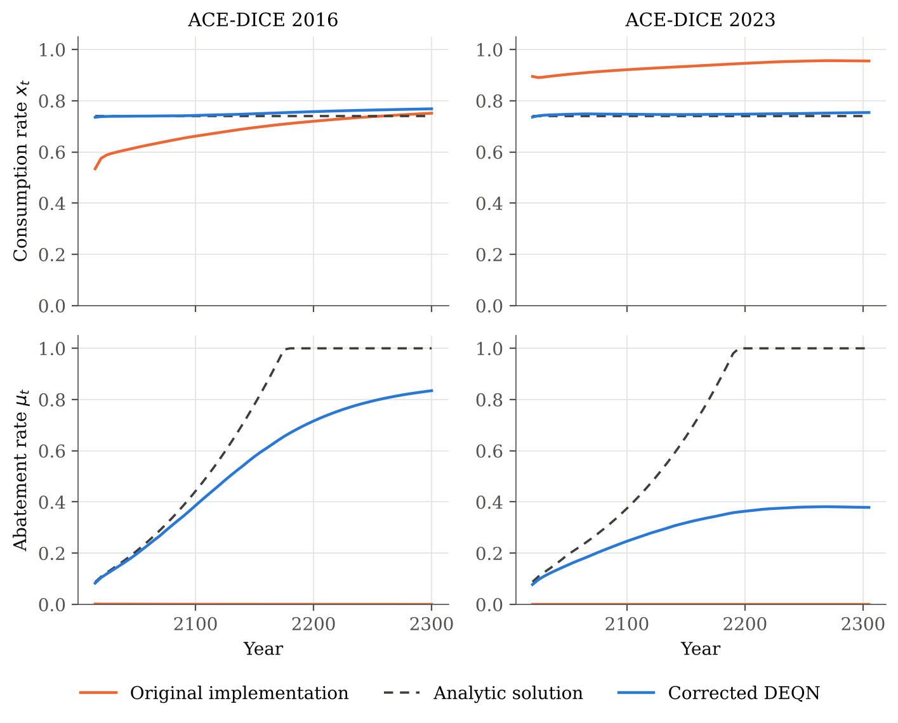

# DNN for ACE — revised

This directory holds a corrected version of the thesis *Deep Equilibrium Nets for the
Analytic Climate Economy* and a rewritten implementation. The original code, results and
checkpoints in the repository root are left untouched for reference.

## What changed

The equilibrium conditions that make up the DEQN policy objective contained errors, both in
the thesis derivations and in `environments/ace_dice/loss_ace_dice.py`:

| Condition | Original | Corrected |
|---|---|---|
| ℓ0, capital costate | Envelope condition drops the direct effect of capital on utility. The code also commented out ∂log F/∂k, leaving `λ_k,t = β λ_k,t+1`. | `λ_k,t = β (1 + λ_k,t+1) ∂log F_{t+1}/∂k_{t+1}` |
| ℓ3, consumption FOC | Counts the effect of saving on future value twice, once as `β ∂V/∂x` and once through `λ_k`. | `1/x_t − λ_k,t / (1 − x_t)` |
| ℓ4, emissions FOC | Same double count, no `λ^BAU`, and no unit conversion from GtCO2 per year to GtC per 5-year period. | `(1 + λ_k,t) ∂log F/∂E + ζ λ_M1,t + λ_E,t − λ^BAU_t`, with `ζ = Δ / 3.664` |
| ℓ2, temperature costate | Thesis eqs. 5.12 and 5.15 used `t` instead of `t+1` on the right-hand side. | Indices fixed. |
| ℓ6, Bellman equation | The code applied the emissions sigmoid twice, so the Bellman residual was evaluated with almost no abatement cost. | Emissions are bounded once in `decode_actions` and reused everywhere. |

At the analytic solution, the original ℓ0 and ℓ3 are not zero, so the network was fitting
a different, wrong fixed point. With the corrected conditions, the analytic solution makes
every residual vanish (see `code/tests/test_residuals.py`).

## Results

With the corrected conditions, the DEQN recovers the analytic solution of ACE closely in both
DICE versions (full tables in [`results/tables/`](results/tables/), figures in
[`results/figures/`](results/figures/)):

| | DICE 2016: DEQN | DICE 2016: analytic | DICE 2023: DEQN | DICE 2023: analytic |
|---|---|---|---|---|
| Consumption rate x | 0.7394 | 0.7395 | 0.7396 | 0.7395 |
| Mean abs. error in abatement rate μ | 0.0009 | – | 0.0020 | – |
| SCC in 2050 (USD/tCO2) | 36.9 | 37.0 | 37.3 | 37.4 |
| Temperature in 2100 (°C) | 2.96 | 2.96 | 3.47 | 3.47 |

The original implementation estimated a consumption rate of 0.53–0.75 (2016) and above 0.89
(2023), and an abatement rate close to zero in both versions.



The revised thesis is available as [`thesis/thesis_revised.pdf`](thesis/thesis_revised.pdf).

## Layout

```
revised/
├── code/                    Rewritten, vectorized implementation (TensorFlow 2)
│   ├── ace_deqn/
│   │   ├── exogenous.py     DICE 2016 / 2023 exogenous paths
│   │   ├── model.py         Equations of motion, action decoding, SCC
│   │   ├── residuals.py     Corrected equilibrium conditions
│   │   ├── analytic.py      Closed-form benchmark (costates, controls, optimal path)
│   │   ├── network.py       Policy network
│   │   └── training.py      DEQN training loop (Algorithm 1)
│   ├── configs/             Model, network, scaling and training settings
│   ├── tests/               The analytic solution satisfies every condition
│   ├── train.py             python train.py --version 2016
│   └── make_results.py      Figures, tables and CSVs from trained networks
├── results/
│   ├── figures/             PDF + PNG figures used in the thesis
│   ├── tables/              Residual statistics and comparison with the benchmark
│   ├── csv/                 Simulated trajectories (network and analytic)
│   └── runs/                Trained weights, training history and logs
└── thesis/                  Revised LaTeX source and compiled PDF
```

## Reproducing

```bash
cd revised/code
pip install tensorflow-cpu pyyaml pandas matplotlib pytest
python -m pytest                 # analytic solution satisfies the corrected conditions
python train.py --version 2016   # ~25 min on a 4-core CPU
python train.py --version 2023
python make_results.py           # writes ../results/{figures,tables,csv}
```

To build the thesis, run `latexmk -pdf -shell-escape main.tex` in `revised/thesis/` and copy
`main.pdf` to `thesis_revised.pdf`. The SVG figure in chapter 3 is converted by Inkscape, which
must be installed.
